# Aerosonic Jet Classifier — Jet Engine Low-Fly Detection

Binary JET vs NO-JET classifier: 16 kHz mono → 5 s windows → log-mel (64 bands) → JetCNN (286k params) → sigmoid.
Training: `train_esc50.py` (baseline) → `train_v1.py` → `train_v2.py` → `train_v3.py` (unified, best-ckpt on AP).
Benchmark: `bench.py` → `benchmarks.csv` + `bench.png`. Report: `make_pdf.py` → `benchmarks.pdf`.

## Results

| model | ESC acc | prec | rec | F1 | BlueAngels | B-1 pass | F-16 | boom |
|---|---|---|---|---|---|---|---|---|
| synth | 0.909 | 0.00 | 0.00 | 0.000 | 0.00 | 0.00 | 0.00 | 0.00 |
| esc50 | 0.648 | 0.21 | 1.00 | 0.340 | 0.96 | 1.00 | 0.87 | 0.00 |
| v1 | 0.886 | 0.40 | 0.50 | 0.444 | 0.39 | 0.98 | 0.65 | 0.00 |
| v2 | 0.932 | 1.00 | 0.25 | 0.400 | 0.07 | 0.98 | 0.22 | 0.00 |

v2 leads on ESC-50 but crowd+music airshow audio regressed. All models score ~0 on sonic booms — needs a separate transient head. Full report: [benchmarks.pdf](benchmarks.pdf).

## Visualization gallery

All figures share one theme (`viz.py`: warm off-white, graphite ink, muted
teal/amber, colorblind-accessible). Every number is computed from real model
outputs — nothing is hardcoded.

### Model comparison (from `benchmarks.csv`)
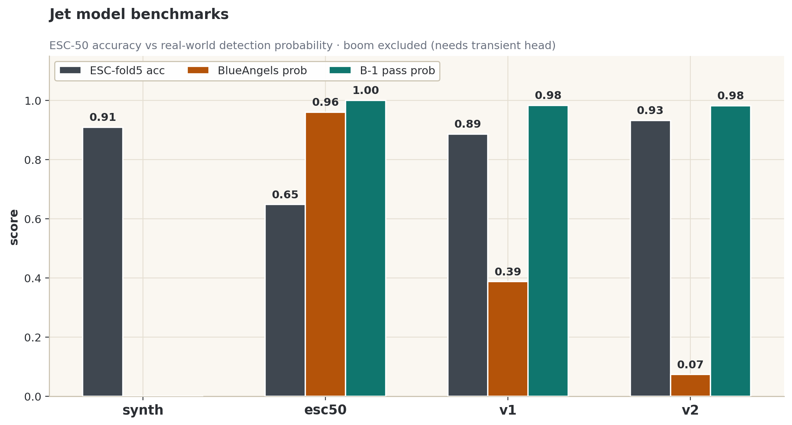

### Learning curves (from `history_*.csv`, held-out test)
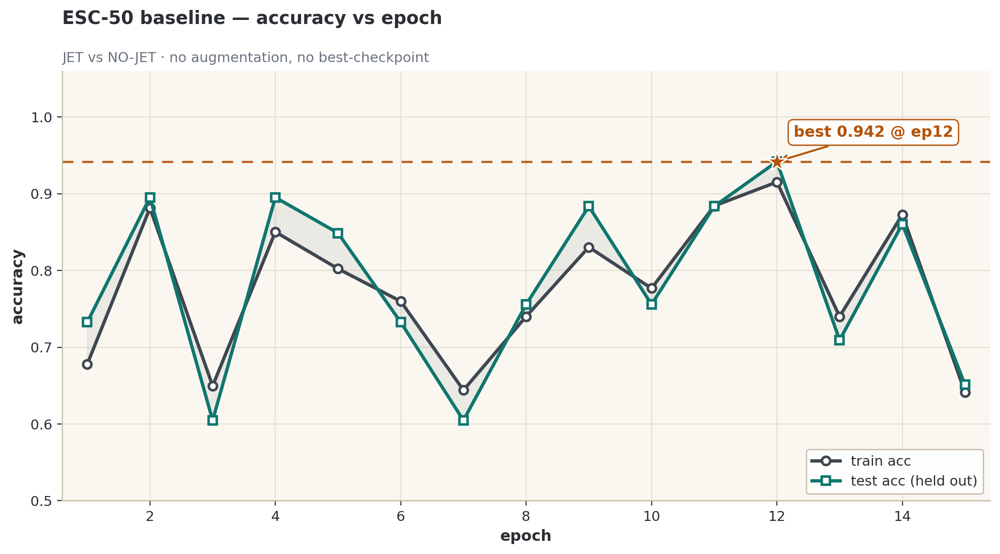
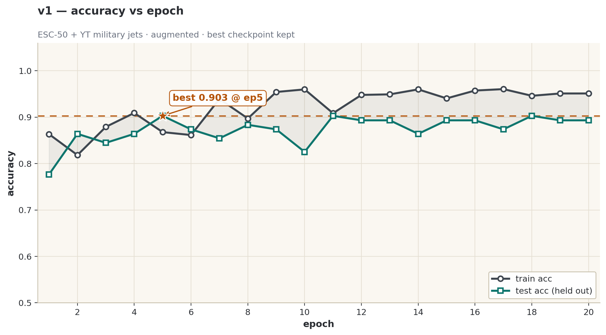
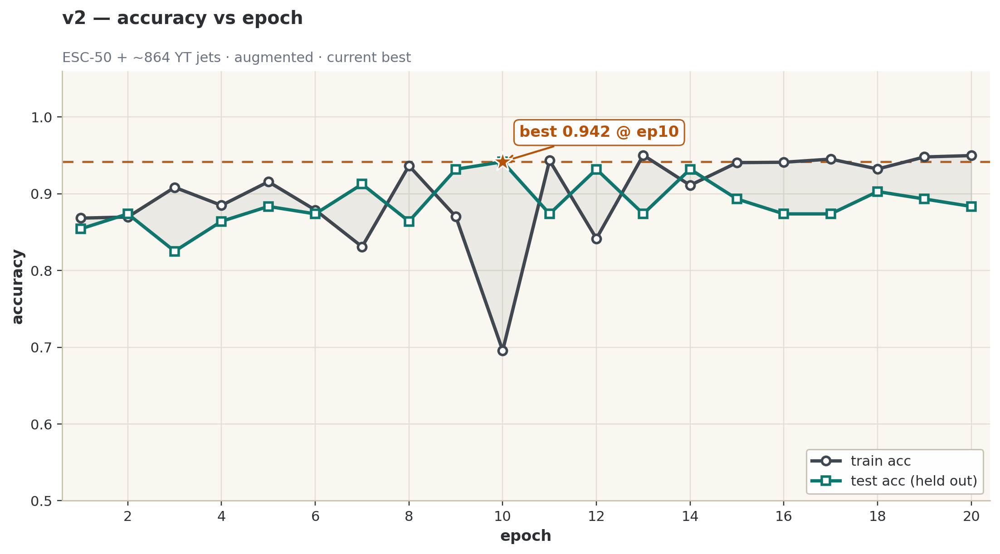

### v2 diagnostics on held-out ESC-50 fold 5 (n=88, 8 JET)
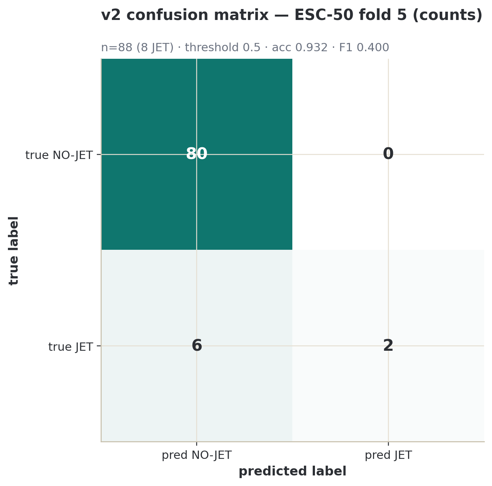
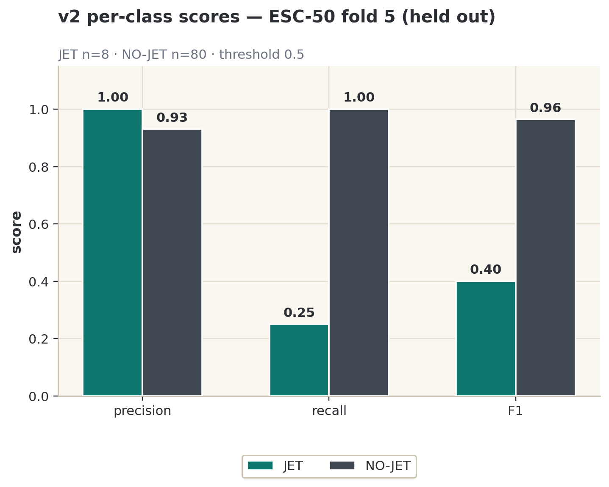
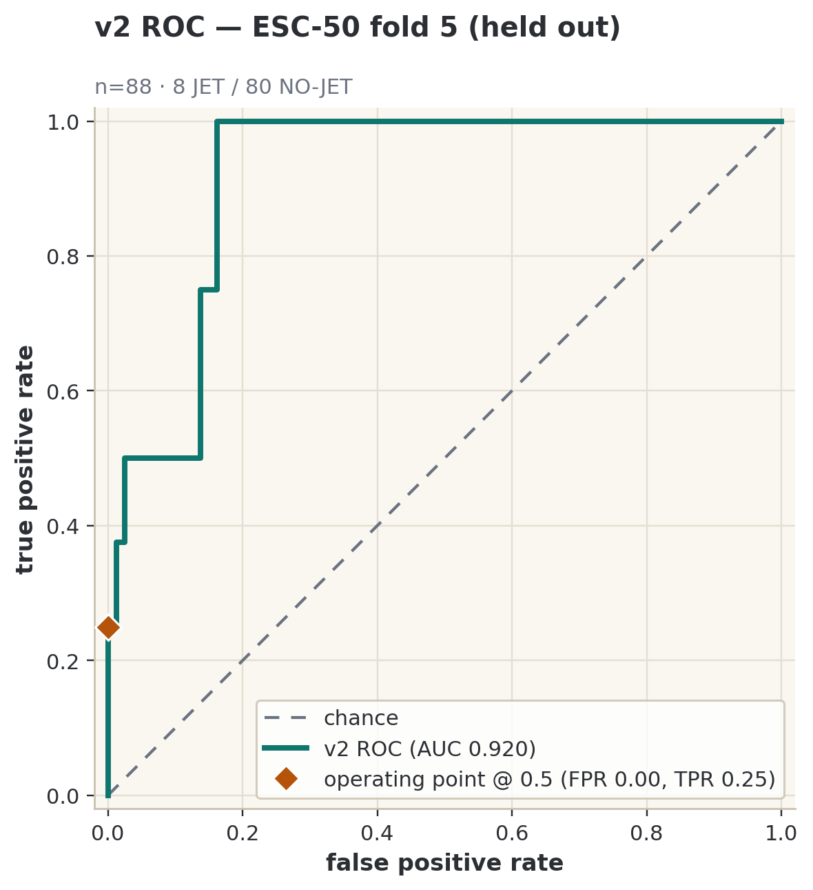
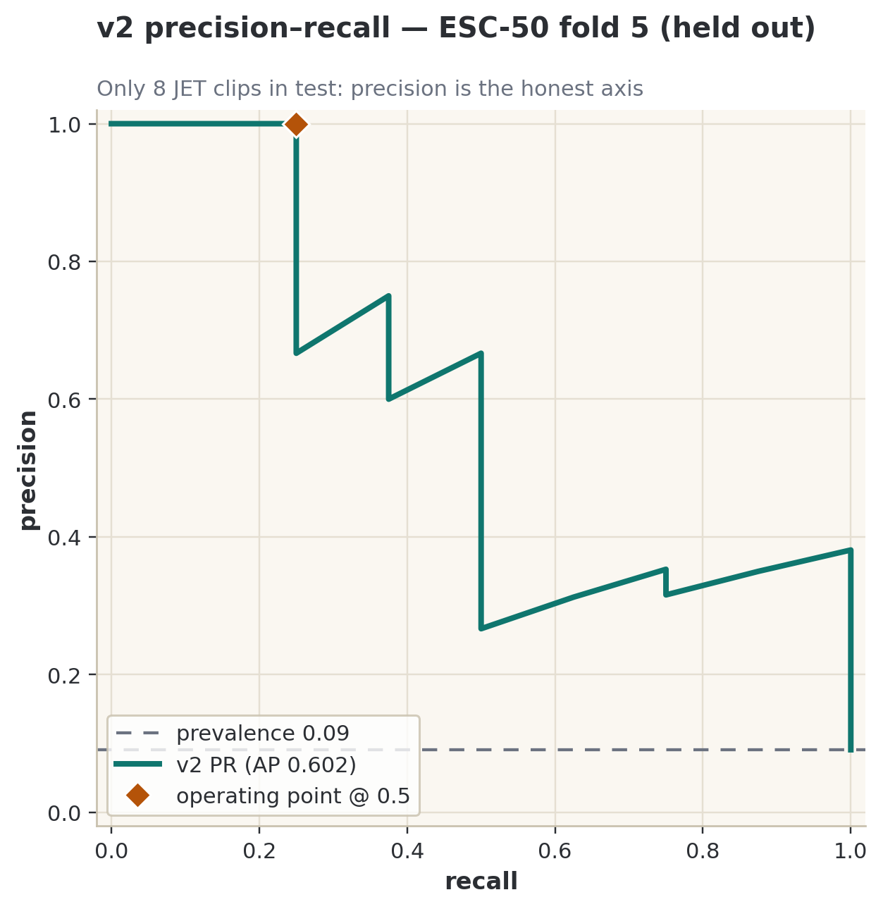
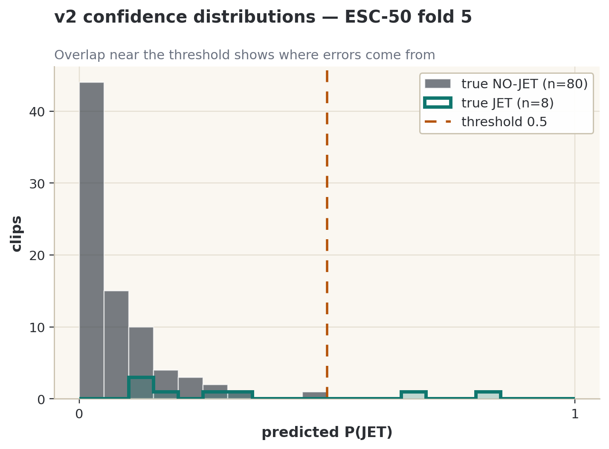
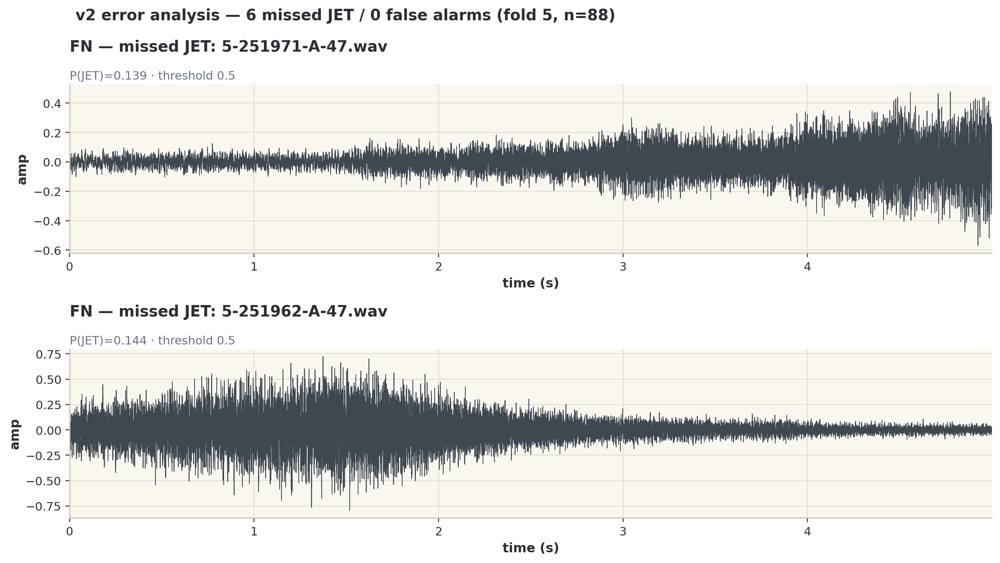

### Data and training
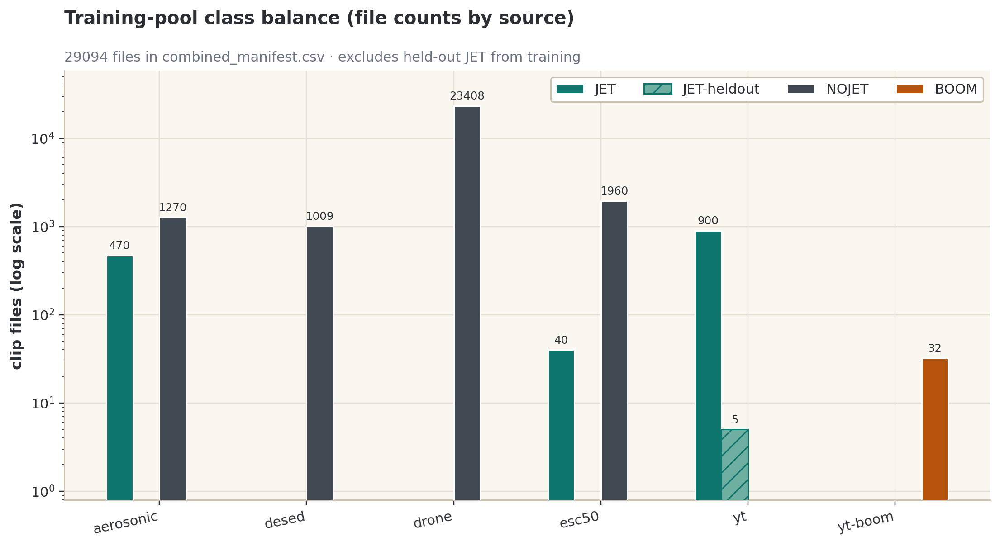
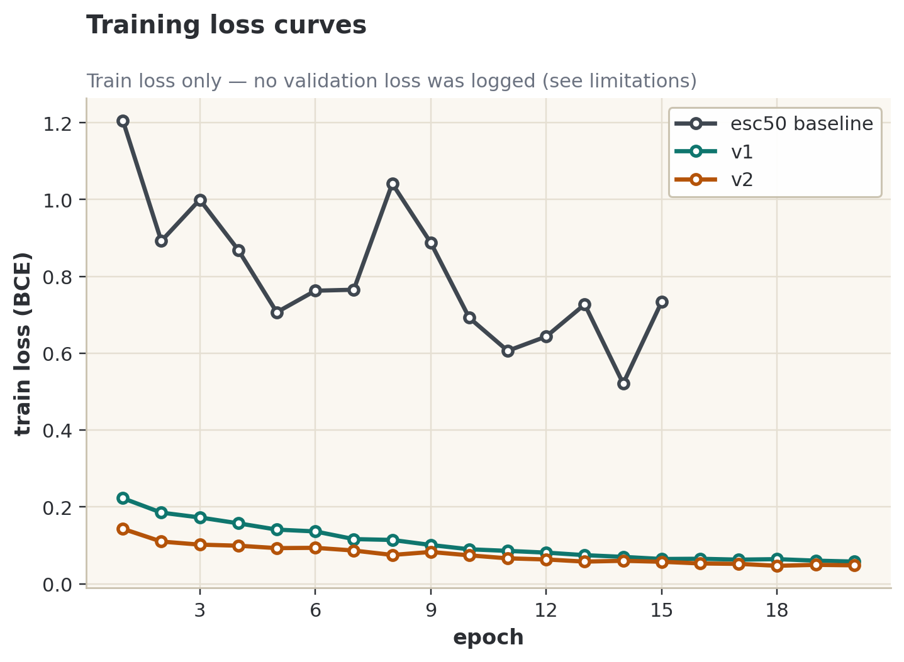

### Sample detection (real clip, `esc50_jet.pt`)
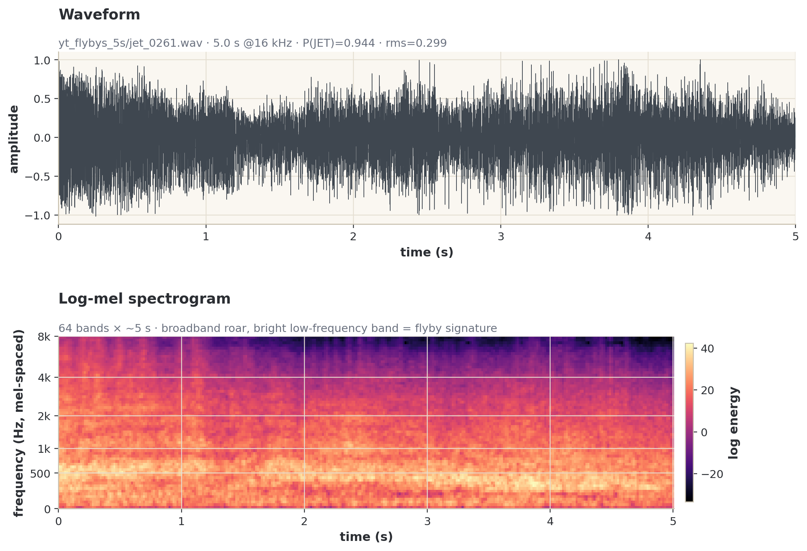

## Regenerating figures

```bash
python3 -m pytest test_viz.py -q   # plotting-system tests (11 tests)
python3 bench.py                   # recompute benchmarks.csv (all 4 models, CPU ok)
python3 make_plots_hq.py           # root PNGs from history_*.csv + benchmarks.csv
python3 make_eval_figs.py          # figures/*.png + *.pdf + metrics_v2.json (v2 on fold 5)
python3 make_pdf.py                # rebuild benchmarks.pdf report
```

`bench.py` writes `benchmarks.csv` only; `bench.png` is rendered from it by
`make_plots_hq.py` (single owner for the publication style). `figures/` holds
PNG (220 dpi) + PDF for every diagnostic figure.

## Limitations (read before citing numbers)

- Test set is tiny: 8 JET clips in fold 5. Recall moves in steps of 1/8;
  no confidence intervals are shown because n=8 cannot support them.
- No validation loss was logged during training, so loss curves are
  train-only; use test-accuracy curves for generalization reads.
- `history_v3.csv` was never saved, so there is no v3 learning curve.
- F-16 scores are new in this run (clips arrived after the first benchmark).
- Boom detection is out of scope for JetCNN (all ~0.00): transient head pending.

## Capture & Review Pipeline

Folders (all in this directory):
- `pending_review/` — recorder drops loud clips here; dashboard reads from here
- `training_dataset/jet/` — confirmed jet clips (your training positives)
- `training_dataset/no_jet/` — rejected clips (training negatives)
- `review_log.csv` — every Yes/No/Delete decision with timestamp
- `events.csv` — recorder loud-event log

## 1. Dashboard (use now)
```bash
cd "/Users/varma/Downloads/AI model/Data"
streamlit run dashboard.py
```
- Pick a clip in **Review**, press play, check the waveform.
- **Yes — jet engine** (or type `yes` in the box) → moves file to `training_dataset/jet/`.
- **No** (or type `no`) → moves to `training_dataset/no_jet/`.
- Safe test file already waiting: `pending_review/selftest_*.wav` (synth tone, no mic involved).

## 2. Recorder (DO NOT mic-test until the OG model is established)
```bash
python3 recorder.py --self-test        # safe now: synth tone, no mic
python3 recorder.py --once             # LIVE MIC: one 10s clip (only after OG model)
python3 recorder.py                    # LIVE MIC: continuous loop (only after OG model)
python3 recorder.py --threshold -30 --clip 10 --sr 16000
```
- macOS mic via ffmpeg/avfoundation, 16 kHz mono to match planned preprocessing.
- Only clips louder than `threshold_dbfs` (see `config.json`) are kept.
- Tune `threshold_dbfs` / `clip_seconds` in `config.json`.

## Notes
- `audio.zip` is still downloading (size growing, central directory incomplete) — left untouched.
- No extra pip packages needed: stdlib + ffmpeg for recorder; streamlit/matplotlib for dashboard (already installed).
